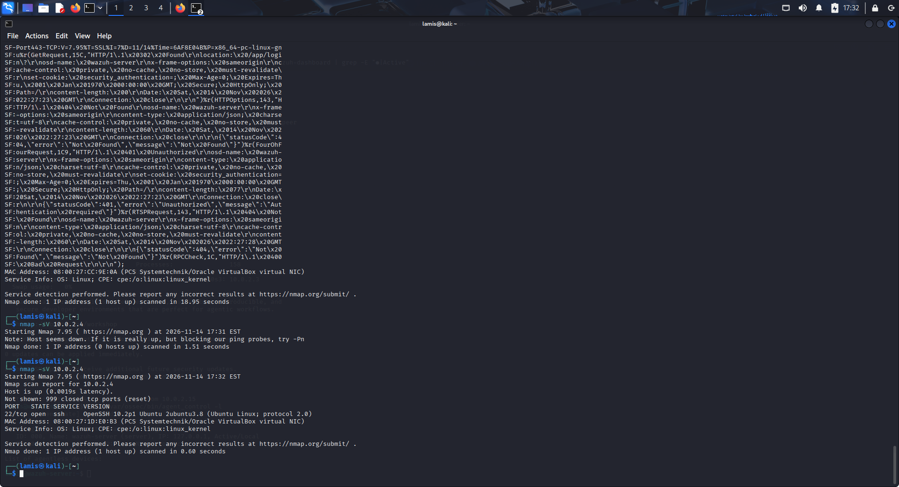
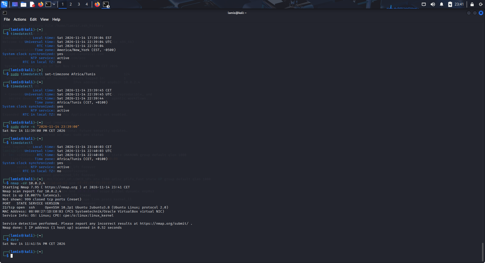
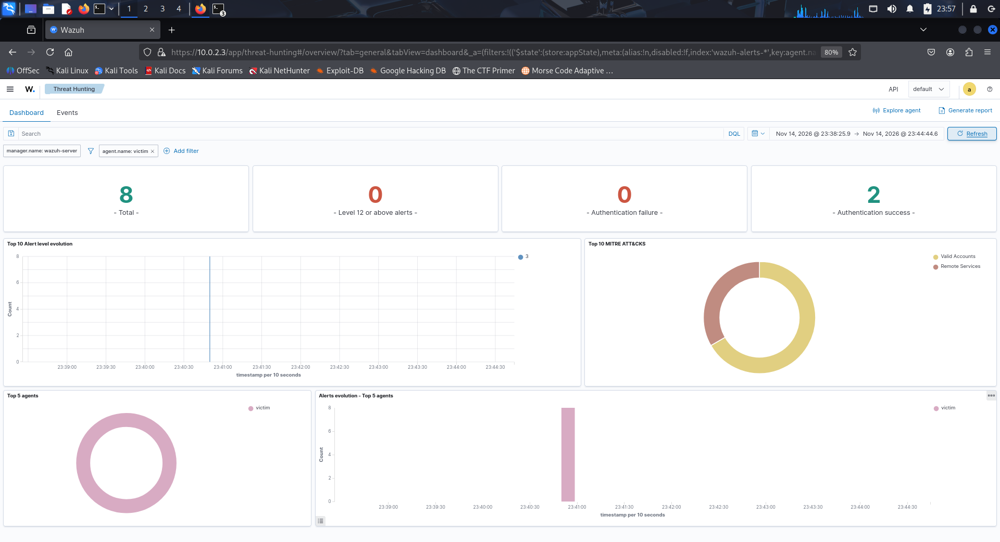

# Attack 1: Port scan with Nmap

## Goal
Discover open ports and running services on `victim`, simulating the reconnaissance step an attacker takes before trying to break in.

## MITRE ATT&CK technique
T1046 - Network Service Discovery

## Command
```
nmap -sV IP_OF_VICTIM
```
Run from Kali at 23:41 (Tunisia time).

## Result of the scan


Port 22 (SSH) was found open, running OpenSSH (see screenshot for exact version).

## Checking Wazuh

I filtered the dashboard to `agent.name: victim` and narrowed the time range to the minutes around the scan (23:38 to 23:44).



8 events appeared in that window, but they were not related to the scan. They showed **Valid Accounts** and **Remote Services** MITRE techniques with 2 successful authentications, which matches an SSH login, not a port scan.



## Conclusion
**Wazuh did not detect the Nmap scan.**

This is expected: Wazuh's default setup analyzes logs and file integrity, not raw network traffic. A plain `nmap -sV` doesn't fail any login or modify any file, so it leaves no trace in the logs Wazuh watches by default.

## What would catch this
A network-based IDS such as Suricata, which Wazuh can integrate with, inspects raw traffic and could flag a port scan pattern (many connections to different ports in a short time) even without any failed login.

## Understanding the tool

Before running this, I made sure I understood what Nmap actually does:

- **Nmap** sends probe packets to a range of ports on a target and reads how it responds to determine which ports are **open** (something is listening), **closed** (nothing listening, but the host responds), or **filtered** (no response, often a firewall).
- The `-sV` flag adds **version detection**: for each open port, Nmap tries to identify the exact software and version running (e.g., "OpenSSH 8.9"), which is valuable to an attacker looking for known vulnerabilities tied to a specific version.

This maps to MITRE ATT&CK **T1046 - Network Service Discovery**, part of the **Discovery** tactic: before trying to break in, an attacker first maps out what's actually running on the target.

## Lesson learned
An alert appearing near the time of an attack doesn't mean it's related to that attack. I had to read the actual log entries (not just the dashboard charts) to confirm the 8 events were my own SSH session, not the scan.
