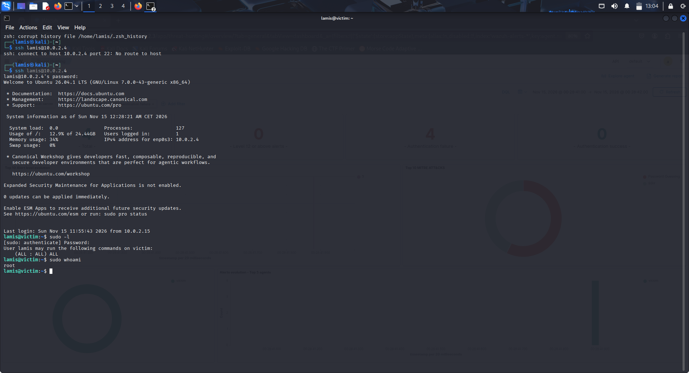
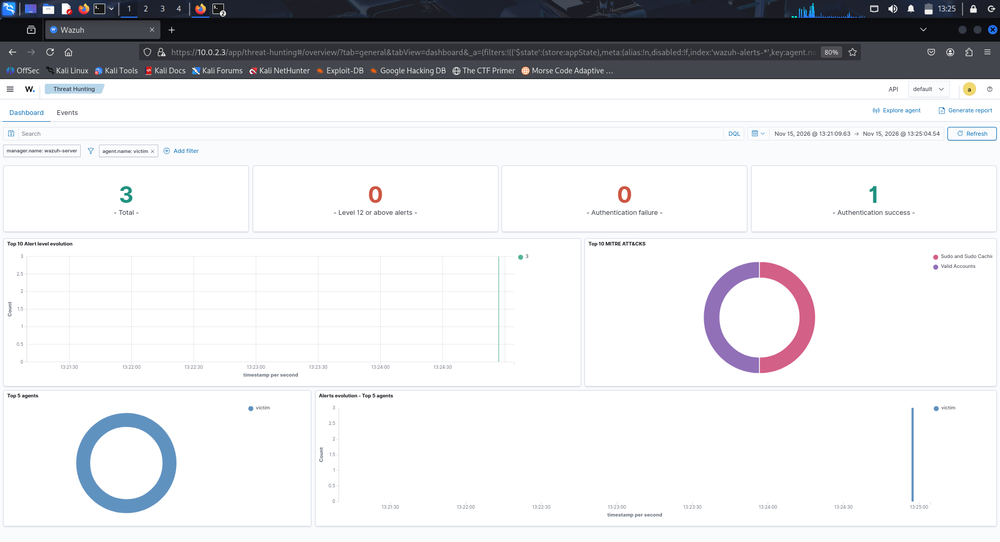
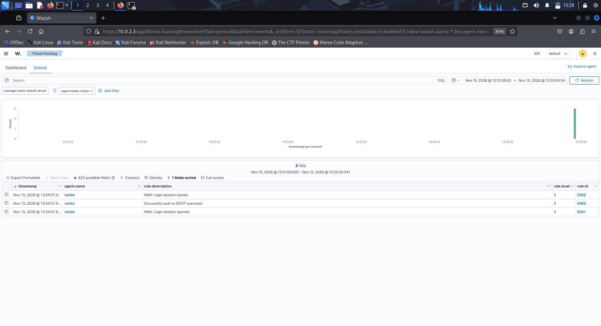

# Attack 3: Login + privilege escalation

## Goal
Use the credentials obtained via Hydra (attack 2) to log in, then demonstrate privilege escalation to root.

## MITRE ATT&CK techniques
- T1078 - Valid Accounts (the login itself)
- T1548 - Abuse Elevation Control Mechanism (sudo usage)

## Commands
```
ssh lamis@10.0.2.4
sudo -l
sudo whoami
```
Run at 13:24 (Tunisia time).

## Result


`sudo whoami` returned `root`, confirming full administrative access was reached from a standard SSH session.

## Checking Wazuh
Filtered `agent.name: victim`, narrowed to 13:21-13:25. Found 3 events: 1 Authentication success and 2 sudo-related events.




## Checking Wazuh
Filtered `agent.name: victim`, narrowed to 13:21-13:25. Found exactly 3 events, all at 13:24:57, all level 3:

| Rule ID | Description |
|---|---|
| 5501 | PAM: Login session opened |
| 5402 | Successful sudo to ROOT executed |
| 5502 | PAM: Login session closed |

These three events correspond exactly to the SSH login, the `sudo whoami` command, and the session ending.

## Conclusion
Wazuh detected both the login and the sudo usage by default, no custom rules needed. This is expected since authentication and sudo commands are both written to standard logs (`auth.log`), which Wazuh monitors out of the box.

## Note
The raw events show PAM session rules (5501, 5502) rather than a distinct "sshd: authentication success" rule, Wazuh appears to categorize this particular login flow under PAM session tracking rather than a separate auth-success rule.
