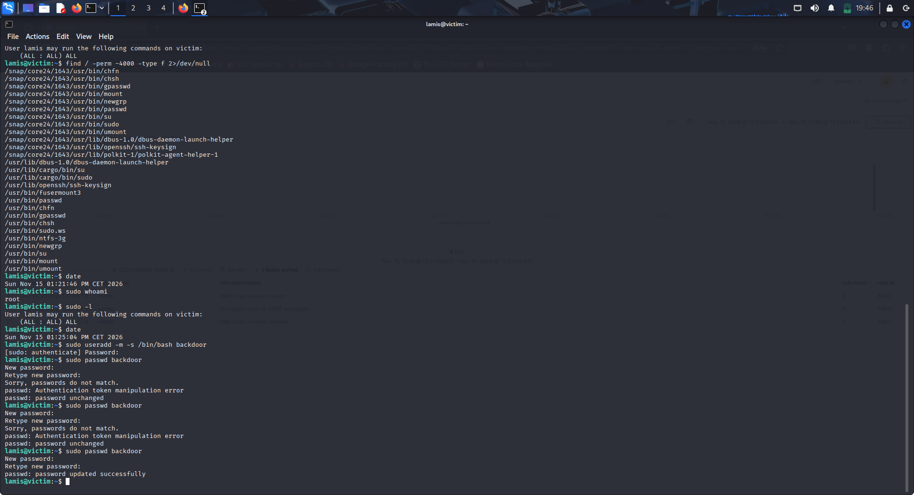
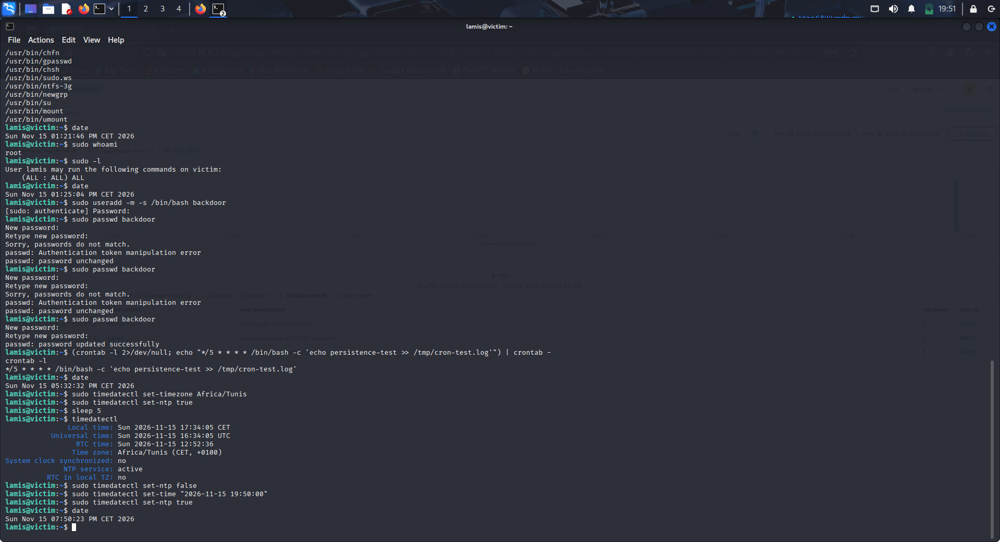

# Attack 4: Persistence (new user + cron job)

## Goal
Simulate what an attacker does after gaining access: establish a way back in that survives the original vulnerability being fixed (e.g., even if the weak password from attack 2 is changed).

## MITRE ATT&CK techniques
- T1136 - Create Account
- T1053 - Scheduled Task/Job

## Commands

**Backup user account:**
```
sudo useradd -m -s /bin/bash backdoor
sudo passwd backdoor
```

**Cron job:**
```
(crontab -l 2>/dev/null; echo "*/5 * * * * /bin/bash -c 'echo persistence-test >> /tmp/cron-test.log'") | crontab -
crontab -l
```

Run at [fill in exact time from `date`].

## Result





Both actions completed successfully: a new user `backdoor` exists on `victim`, and a cron job runs every 5 minutes.

## Checking Wazuh
Filtered `agent.name: victim`, narrowed the time range to the minutes around both actions.


**No alerts appeared for either action.**

## Conclusion
**Wazuh did not detect this attack.** Unlike the SSH brute force and privilege escalation (attacks 2-3), which write to `/var/log/auth.log` and are covered by default log analysis, these persistence techniques modify files (`/etc/passwd`, `/etc/shadow`, cron files) that are not watched by Wazuh's default File Integrity Monitoring (FIM) configuration.

See the full analysis in [detections/04-persistence-detection-gap.md](../detections/04-persistence-detection-gap.md).

## Lesson learned
Default SIEM configurations have blind spots. Authentication-based attacks (brute force, login, sudo) are well covered out of the box because they rely on standard logs. Persistence techniques that modify specific files require explicitly configuring File Integrity Monitoring to watch those paths, coverage isn't automatic just because a tool is installed.
