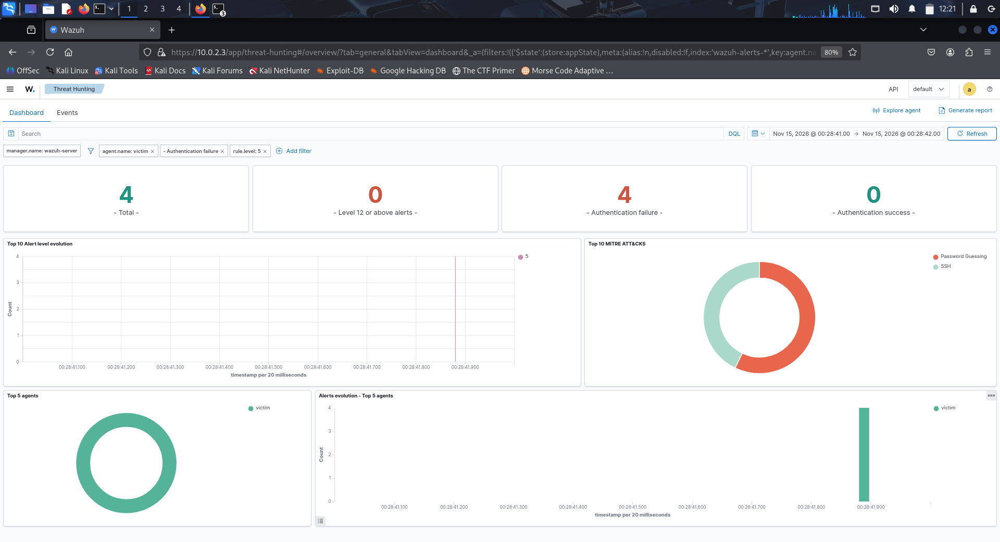

# Default detection: SSH brute force (T1110)

## What happened
Hydra brute-forced victim's SSH password (see [attacks/02-hydra-bruteforce.md](../attacks/02-hydra-bruteforce.md)). Wazuh logged 5 "Authentication failure" events and 1 "Authentication success" event.

## Which rule caught it
Rule ID: [fill in], Description: "[fill in]"

## Why this worked by default
Failed and successful SSH logins are written directly to `/var/log/auth.log`, which Wazuh's agent reads and forwards. This falls squarely into Wazuh's default log-analysis scope, no extra configuration was needed.

## Possible improvement
Wazuh has a built-in correlation rule for "multiple authentication failures from the same source" (active response can even block the IP automatically). I could enable **active response** to automatically firewall-block an IP after N failed attempts, turning detection into actual prevention.

## Status
Working by default. Active response enhancement not yet implemented.
