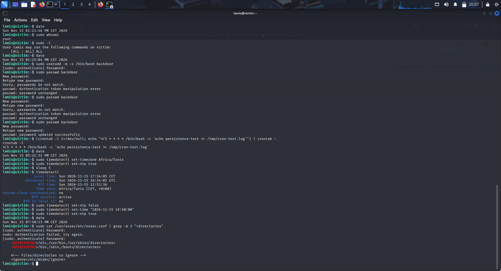

# Detection gap: Persistence via new user and cron job (T1136, T1053)

## What happened
I created a backup user account (`backdoor`) and a cron job on `victim` (see [attacks/04-persistence.md](../attacks/04-persistence.md)). No alert appeared in Wazuh for either action.

## MITRE ATT&CK techniques
- T1136 - Create Account
- T1053 - Scheduled Task/Job

## Why Wazuh missed it
Wazuh's File Integrity Monitoring (FIM) only watches a pre-configured list of directories and files, defined in the `<syscheck>` section of `ossec.conf`. By default, this list does not necessarily include `/etc/passwd`, `/etc/shadow`, or cron directories like `/var/spool/cron/crontabs/`.

Checked the current FIM configuration on `wazuh-server`:
```
sudo cat /var/ossec/etc/ossec.conf | grep -A 3 "<directories"
```



## Why this matters
This is a realistic and known blind spot. An attacker who gains initial access (as simulated in attacks 2-3, both of which were detected) can create persistence mechanisms that go completely unnoticed unless FIM is specifically configured to watch the right paths. A SIEM that catches the break-in but misses the backdoor gives a false sense of security.

## How to close this gap
Add the relevant paths to the `<syscheck>` section of `ossec.conf` on `wazuh-server`:
```xml
<directories realtime="yes">/etc/passwd,/etc/shadow,/etc/group</directories>
<directories realtime="yes">/var/spool/cron/crontabs</directories>
```
Then restart the Wazuh manager (and the agent's FIM scan) and re-run the persistence attack to confirm detection.

## Status
Gap confirmed and documented. Fix implemented and re-tested: see [05-fim-fix-verification.md](05-fim-fix-verification.md).
