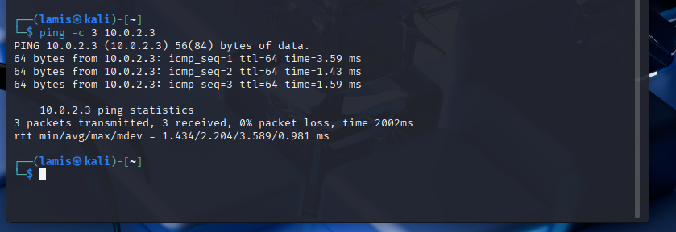

# Network setup

## Goal
Connect all lab machines to an isolated NAT Network so they can reach each other and the Internet, without being exposed to my home network.

## Configuration
- Network name: `soc-lab`
- Type: VirtualBox NAT Network
- Range: `10.0.3.0/24` (DHCP enabled)
- Machines: kali, wazuh-server, victim

## Verification on Kali
The command `ip a` shows that Kali has an address on the lab network, and `ping` confirms Internet access (3 packets sent, 3 received, 0% loss).

## Notes
The first ping times were high (180 to 690 ms), caused by my slow Internet connection, not by the lab.

# Network setup

## Goal
Connect all lab machines to an isolated NAT Network so they can reach each other and the Internet, without being exposed to my home network.

## Configuration
- Network name: `soc-lab`
- Type: VirtualBox NAT Network
- Range: `10.0.2.0/24` (DHCP enabled)
- Machines: kali, wazuh-server, victim

## Verification 1: Kali has network and Internet access
`ip a` shows that Kali has an address on the lab network, and `ping google.com` returns 3 replies with 0% packet loss.

## Verification 2: Kali can reach wazuh-server
`wazuh-server` has the address `10.0.2.3`. Kali pings it with 3 replies and 0% packet loss, which confirms that both machines are on the same lab network.

## Problems encountered
- The first pings froze with no output. The cause was a typo: I typed `-C` (capital) instead of `-c` (lowercase). Fixed by using `ping -c 3 10.0.2.3`.
- Latency to the Internet was high (180 to 690 ms), caused by my Internet connection, not by the lab.
