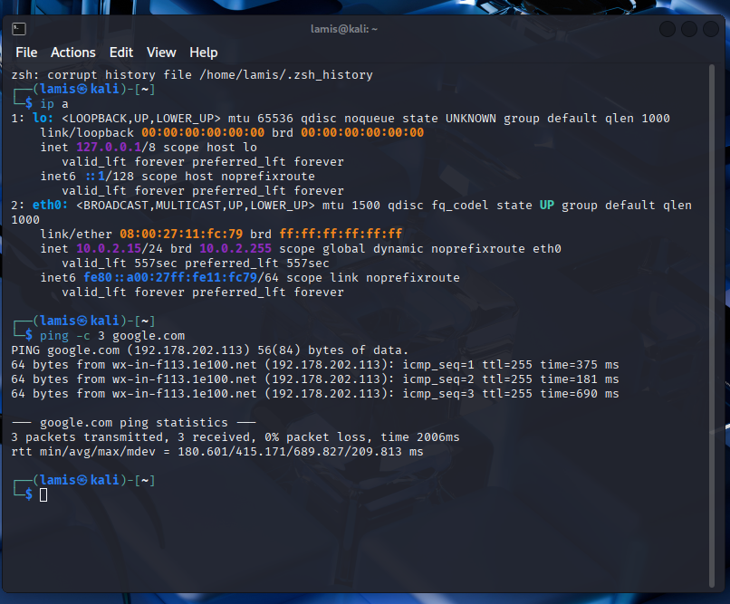

# Network setup

## Goal
Connect all lab machines to an isolated NAT Network so they can reach each other and the Internet, without being exposed to my home network.

## Configuration
- Network name: `soc-lab`
- Type: VirtualBox NAT Network
- Range: `10.0.3.0/24` (DHCP enabled)
- Machines: kali, wazuh-server, victim

## Verification on Kali
The command `ip a` shows that Kali has an address on the lab network, and `ping` confirms Internet access (3 packets sent, 3 received, 0% loss).

## Notes
The first ping times were high (180 to 690 ms), caused by my slow Internet connection, not by the lab.
