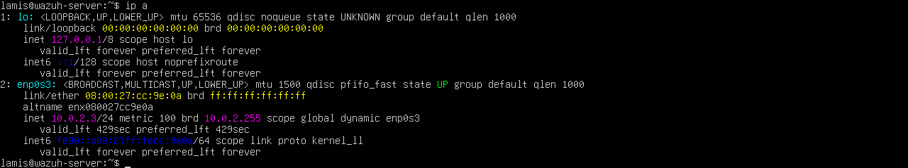

# Ubuntu Server installation (wazuh-server)

## Goal
Create the VM that will host the Wazuh SIEM.

## VM settings
- Name: `wazuh-server`
- OS: Ubuntu Server LTS (26.04)
- RAM: 4 GB at first (raised to 6 GB for Wazuh), CPUs: 2, disk: 25 GB (dynamic)
- Network: NAT Network `soc-lab`
- IP: `10.0.2.3`

## What I did
1. Verified the ISO checksum, created the VM, and ran the installer.
2. Updated the system with `apt update && apt upgrade`.
3. Switched the keyboard to French AZERTY.
4. Installed the OpenSSH server so Kali can connect.
5. Took a snapshot before cloning.

## Result

## Problems encountered
- **Symptom:** keyboard was QWERTY.
  **Cause:** `loadkeys` only lasts until reboot.
  **Fix:** `dpkg-reconfigure keyboard-configuration`, layout French.
- **Symptom:** `apt update` failed with "Release file is not valid yet".
  **Cause:** the VM clock was about 11 hours behind and NTP sync wasn't working.
  **Fix:** `timedatectl set-ntp false`, then `timedatectl set-time`, then `apt update`.
- **Symptom:** SSH from Kali: "connection refused".
  **Cause:** I hadn't installed the OpenSSH server during the install.
  **Fix:** `apt install openssh-server` and `systemctl enable --now ssh`.

## Next
Clone the VM as `victim`, then install Wazuh.
