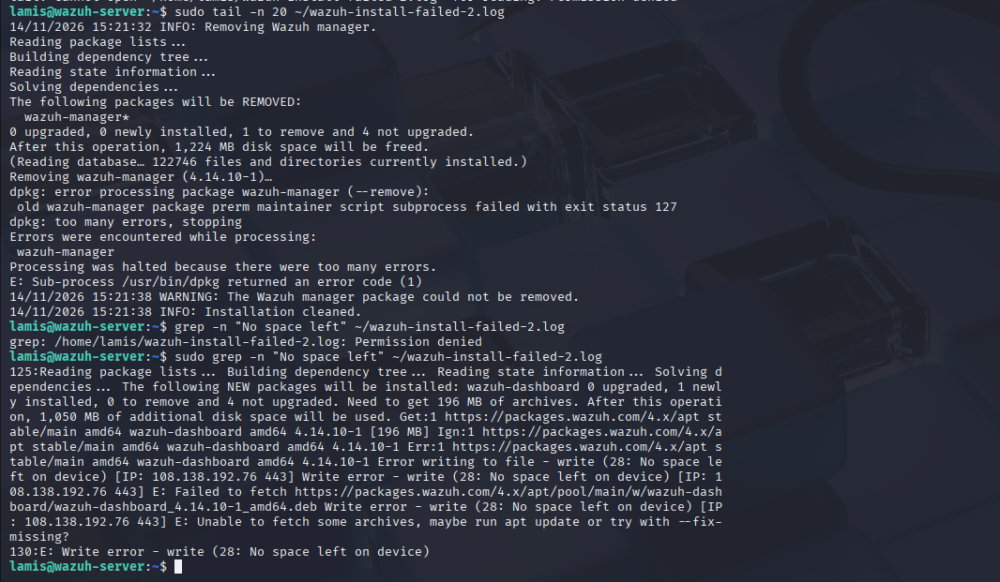
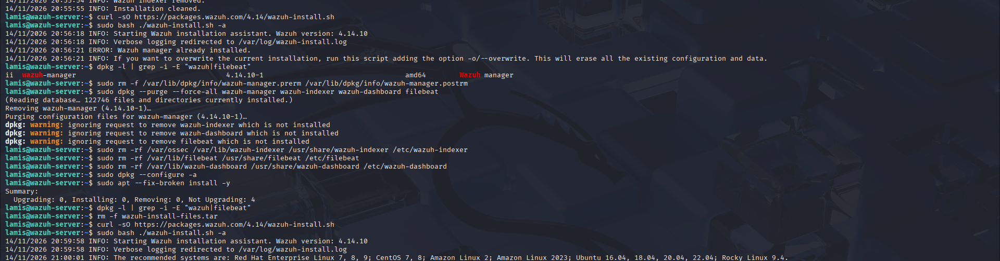

# Wazuh installation

**Status:** in progress

## Goal
Install Wazuh (manager, indexer and dashboard) on `wazuh-server` with the official installation assistant, so that Wazuh can monitor `victim` and I can run attacks against it.

## Setup
- Wazuh version: 4.14.10, all-in-one install (`wazuh-install.sh -a`)
- VM: Ubuntu Server 26.04, 6 GB RAM, 2 CPUs, 25 GB disk
- Ubuntu 26.04 is not in the assistant's list of recommended systems. It only prints a warning and continues.

## Problems encountered

### 1. Installer interrupted by mistake
- **Symptom:** the assistant asked whether to remove the ongoing installation.
- **Cause:** I pressed Ctrl+C while it was running.
- **Fix:** answered `N` and re-ran the assistant, which continued normally.

### 2. Dashboard step failed and the assistant rolled back everything
- **Symptom:** `ERROR: Wazuh dashboard installation failed`, then the manager, the indexer and Filebeat were removed.
- **Cause:** not captured, because I re-ran the installer and the log was overwritten.
- **Lesson:** read the log before running the installer again.

### 3. Retry failed with `wazuh-keystore: No such file or directory`
- **Symptom:** the manager "installed" in a few seconds and `wazuh-manager could not be started`.
- **Cause:** the earlier rollback left the package registered but deleted its files.

### 4. `dpkg --purge wazuh-manager` failed with `exit status 127`
- **Symptom:** the assistant kept answering "Wazuh manager already installed".
- **Cause:** the package's removal script called a Wazuh program that no longer existed.
- **Fix:** delete the broken scripts in `/var/lib/dpkg/info/`, then force-remove and purge the package, delete the leftover folders, and run `dpkg --configure -a`.

### 5. Dashboard download failed with `No space left on device`
- **Symptom:** the log shows `Error writing to file - write (28: No space left on device)` while downloading the dashboard package (196 MB).
- **How I found it:** `grep` on `/var/log/wazuh-install.log`.
- **What I ruled out:**
  - `df -h /` showed 19 GB available and 21% used
  - inodes were at 7%
  - the Windows drive had 238 GB free
- **Cause:** to be determined. Next step: watch the disk with `watch -n 5 df -h /` during the install.
- **Fix:** to be filled in.

## What I learned
- Read the installer log before re-running it, because each run overwrites it.
- A failed rollback can leave a package half-registered in dpkg.
- Take a snapshot before any large install.
- Rule out hypotheses with measurements instead of guessing.

### 6. Hypothesis: the VM was under-resourced

After three failed installs at the same step, I considered switching to the pre-built OVA. Before doing that, I decided to test a resource hypothesis: my VM (6 GB RAM, 25 GB disk) was below Wazuh's recommended resources, which may have caused the download or the install to fail.

**What I changed**
- Enlarged the virtual disk from 25 GB to 50 GB, then extended the partition and the filesystem (`growpart`, `resize2fs`).
- Raised the RAM from 6 GB to 8 GB.
- Added a 4 GB swap file.

**How I measured it**
- A loop recorded `free -h` and `df -h /` every 15 seconds during the install into `watch.log`.
- I took a snapshot (`Clean before Wazuh`) before the new attempt, so a failure would cost seconds.

**Result:** (fill in: it worked, or it failed with this error, and what the recorder showed)

**Decision:** (fill in: keep this setup, or switch to the OVA)

## Result
To be added once the dashboard opens (a screenshot of the login page and the home page, without the password).

## Next
Install the Wazuh agent on `victim`.
