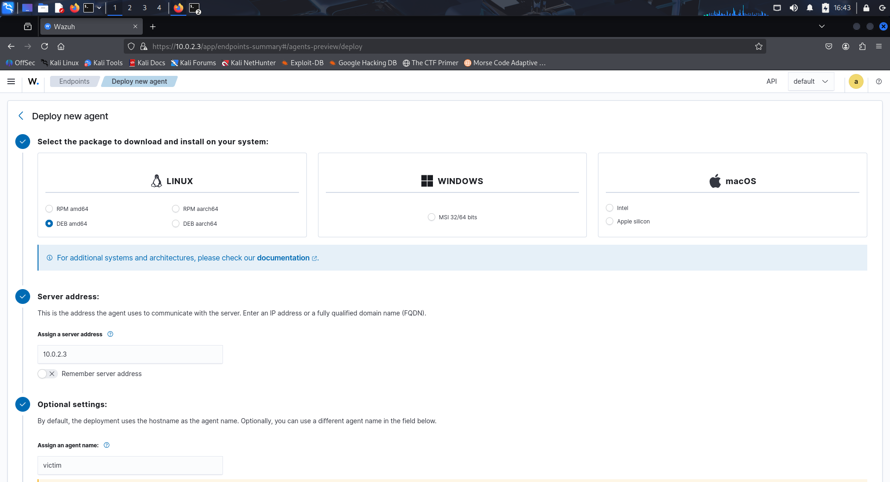
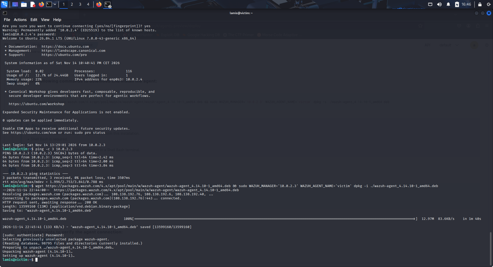
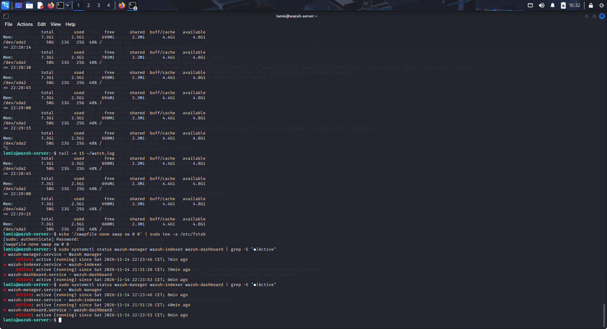
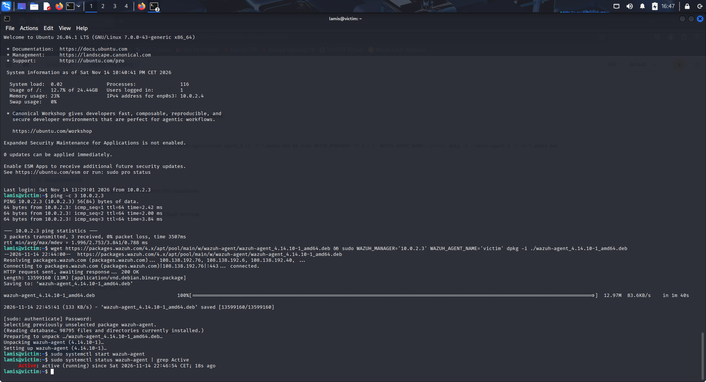
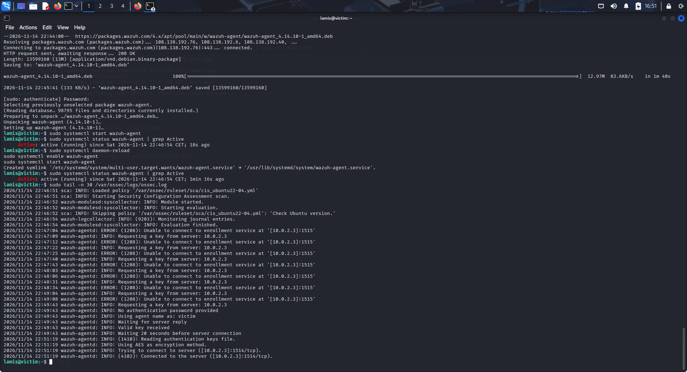

## Wazuh agent installation
1. In the Wazuh dashboard, **Agents > Deploy new agent**: Linux, DEB amd64, server address `10.0.2.3`, agent name `victim`.

2. Ran the generated command on `victim` over SSH, then started the service.

## Result
`victim` appears as **Active** in the dashboard and in `agent_control -l`.

